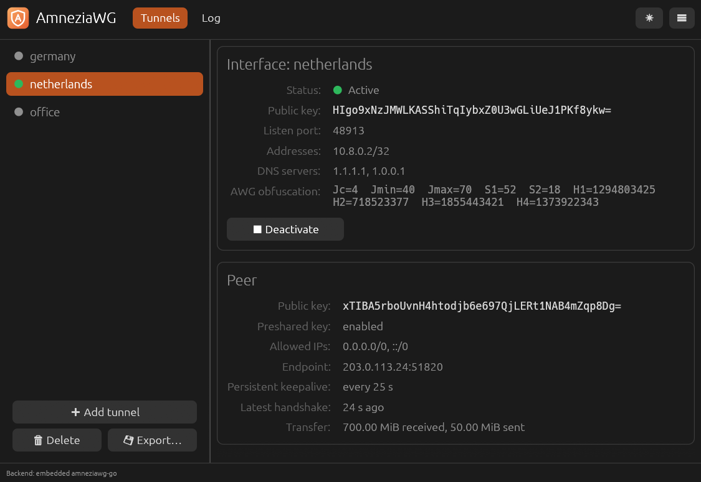
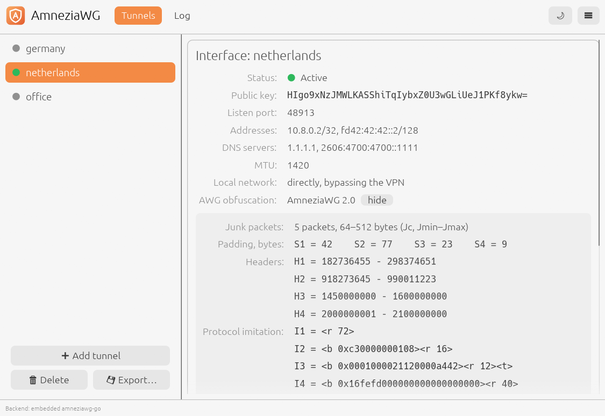
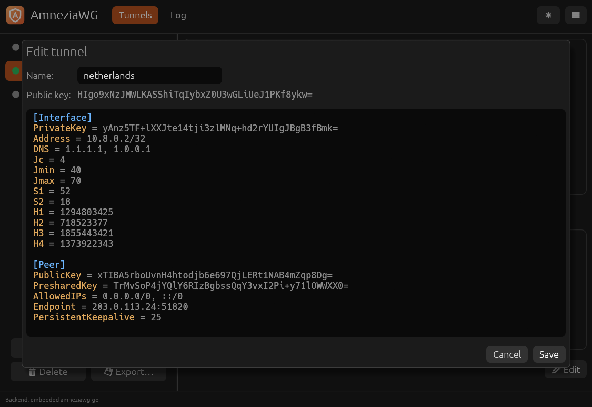

[English](README.md) | [Русский](README.ru_RU.md)

<p align="center">
  
</p>

<h1 align="center">AmneziaWG client for Linux</h1>
<p align="center">A graphical AmneziaWG / WireGuard VPN client for Linux in one executable.</p>

[](https://github.com/coinman-dev/awg-linux-client/releases/tag/v0.1.0-beta)
[](https://github.com/coinman-dev/awg-linux-client/actions/workflows/release.yml)
[](#download)
[](#building)
[](LICENSE)

**awg-gui** is a desktop client for [AmneziaWG](https://docs.amnezia.org/documentation/amnezia-wg/),
the WireGuard fork with traffic obfuscation, made for Linux after the example of
[amneziawg-windows-client](https://github.com/amnezia-vpn/amneziawg-windows-client). It is written
in Rust from scratch; the window is drawn with [egui](https://github.com/emilk/egui), so there is no
toolkit to install. The userspace AmneziaWG implementation (`amneziawg-go`) and the `awg` /
`awg-quick` tools are built into the program: it works without the kernel module and without
any other AmneziaWG packages.

<p align="center">
  
</p>

> **0.1.0-beta is the first prerelease.** Please report problems on
> [GitHub Issues](https://github.com/coinman-dev/awg-linux-client/issues) and attach the text
> from the **Log** tab. awg-gui is an independent project and is not affiliated with Amnezia.

## Download

| Edition | Download | Usage |
|---|---|---|
| Linux package | [awg-gui_0.1.0-beta_amd64.deb](https://github.com/coinman-dev/awg-linux-client/releases/download/v0.1.0-beta/awg-gui_0.1.0-beta_amd64.deb) | `sudo apt install ./awg-gui_0.1.0-beta_amd64.deb` installs the program with its menu entry, icons and polkit policy. |

Ubuntu 24.04 or newer, Debian 13 or newer, amd64, Wayland or X11 with OpenGL.
No advertising or telemetry; the program connects only to your VPN servers.
[All releases](https://github.com/coinman-dev/awg-linux-client/releases) ·
[Changelog](CHANGELOG.md).

## Quick start

1. Install the package: `sudo apt install ./awg-gui_0.1.0-beta_amd64.deb`.
2. Open **AmneziaWG** from the application menu (**Internet**) or run `awg-gui`.
3. **Add tunnel** → import a `.conf` file, paste the text of a config or an AmneziaVPN
   `vpn://` key, or drop files onto the window.
4. Click **Activate** and enter the administrator password (asked once per session).
   Closing the window keeps the program in the system tray.

## Features

- **Tunnel list** with status indicators; connect and disconnect with a button, a double click
  or from the tray menu. Like the Windows client, one tunnel is active at a time.
- **Import**: `.conf` files (file dialog or drag and drop), pasted config text, **AmneziaVPN
  `vpn://` keys**; `awg-gui --import FILE…` from the terminal.
- **Editor** with syntax highlighting and live public key; **new empty tunnel** with a
  freshly generated key pair; export and delete.
- **Live statistics**: latest handshake, received and sent traffic, endpoint, listen port and
  the AmneziaWG obfuscation parameters (Jc, Jmin, Jmax, S1–S4, H1–H4, I1–I5).
- **AmneziaWG 1.0, 1.5, 2.0, 3.0 and 3.1** configs as well as plain WireGuard; the version is detected
  and the obfuscation parameters are shown one readable row per group.
- **Bypass VPN for local networks** (☰ menu): with a full-tunnel config, private addresses
  (192.168.x.x, 10.x.x.x, 172.16–31.x.x, link-local, IPv6 ULA) go directly, so printers, NAS
  and the router stay reachable; addresses inside the tunnel (its subnet, private DNS) still go
  through the VPN. Implemented with `ip rule`s added to the runtime copy of the config; the
  saved config is not changed.
- Light, dark and system themes; English and Russian interface; operation log.

<p align="center">
  
  
</p>

## Desktop integration

- **System tray** (StatusNotifierItem): closing the window hides the program to the tray;
  the tray menu opens the window, toggles tunnels and quits. The icon is coloured while a
  tunnel is connected and grey otherwise. KDE Plasma supports it natively; GNOME needs the
  AppIndicator extension (enabled by default in Ubuntu). Without a tray closing the window
  quits the program.
- **Autostart** at login, straight into the tray (☰ menu → **Start on login**).
- **Single instance**: launching the program again shows the window of the running one.
- **Tunnels stay up** after the window is closed and after quitting, like the Windows
  services of the original client.

## How it works

```
awg-gui (your user, GUI)
   │  JSON over stdin/stdout
   ▼
pkexec awg-gui --helper (root, the same executable)
   │
   ▼
awg-quick up/down, awg show all dump
   │
   ▼
amneziawg kernel module  OR  amneziawg-go (system or built-in)
```

The privileged helper is started through polkit once per session; the package installs a
policy (`org.amnezia.awg-gui.helper`) with a clear message and a few minutes of remembered
authorization. System-installed `awg`, `awg-quick`, `amneziawg-go` and the kernel module take
precedence over the built-in copies.

## Settings and data

| What | Where |
|---|---|
| Program | `/usr/bin/awg-gui` |
| Tunnel configs | `~/.config/awg-gui/tunnels/<name>.conf` (mode 0600) |
| Settings (language, theme, local network bypass) | `~/.config/awg-gui/settings.json` |
| Copy of the config of an active tunnel | `/run/awg-gui/<name>.conf` (root, needed for `awg-quick down`) |
| Built-in `amneziawg-go`, `awg`, `awg-quick` | unpacked to `/var/lib/awg-gui/bin/` when first needed |
| Autostart entry | `~/.config/autostart/awg-gui.desktop` |

Tunnel names follow the Linux interface rules: up to 15 characters from `a-z A-Z 0-9 _ = + . -`.

## Command line

```bash
awg-gui                  # start the GUI
awg-gui --minimized      # start in the system tray
awg-gui --import FILE…   # import .conf files or files with vpn:// keys
awg-gui --install        # add a menu entry for a binary run without the package
awg-gui --help
```

## Building

Requires Rust 1.95+, a C compiler (`build-essential`), `git` and `curl`; Go is downloaded
automatically if it is not installed. No system libraries are needed for building.

```bash
packaging/build-backend.sh     # amneziawg-go, awg, awg-quick into vendor/ (embedded by build.rs)
cargo test --locked
cargo build --release --locked # target/release/awg-gui, ~14 MB, depends only on libc
packaging/build-deb.sh         # dist/awg-gui_<version>_<arch>.deb
```

Without the built-in backend: `AWG_GUI_NO_EMBED=1 cargo build --release` (then the system
needs `amneziawg-tools` and the kernel module or `amneziawg-go`).

Screenshots without a VPN server (debug builds): `AWG_GUI_SCREENSHOT=out.png` saves the window
and quits, `AWG_GUI_DEBUG=helper|editor|paste|log` opens a view, `AWG_GUI_FAKE_ACTIVE=name`
marks a tunnel as active, `AWG_GUI_THEME=light|dark` selects the theme.

## Automated releases

Pushing a version tag such as `v0.1.0-beta` runs the
[release workflow](.github/workflows/release.yml). The tag must match `version` in
`Cargo.toml`. GitHub builds the backend and the program on Ubuntu 24.04, runs the tests,
builds and checks `awg-gui_<version>_amd64.deb`, computes `SHA256SUMS.txt` and publishes the
release. Tags with a hyphen suffix are marked as prereleases.

## License

GNU General Public License v2 or later — see [LICENSE](LICENSE).

Built-in components keep their own licenses: [amneziawg-go](https://github.com/amnezia-vpn/amneziawg-go)
(MIT), [amneziawg-tools](https://github.com/amnezia-vpn/amneziawg-tools) (`awg`, `awg-quick`,
GPL-2.0), and the Rust crates the program is built from (egui, winit, ksni, zbus and others,
MIT or Apache-2.0), including the fonts bundled with egui (Hack, Ubuntu Light, Noto Emoji,
emoji-icon-font) under their own free licenses. AmneziaWG and WireGuard are trademarks of their
respective owners.
