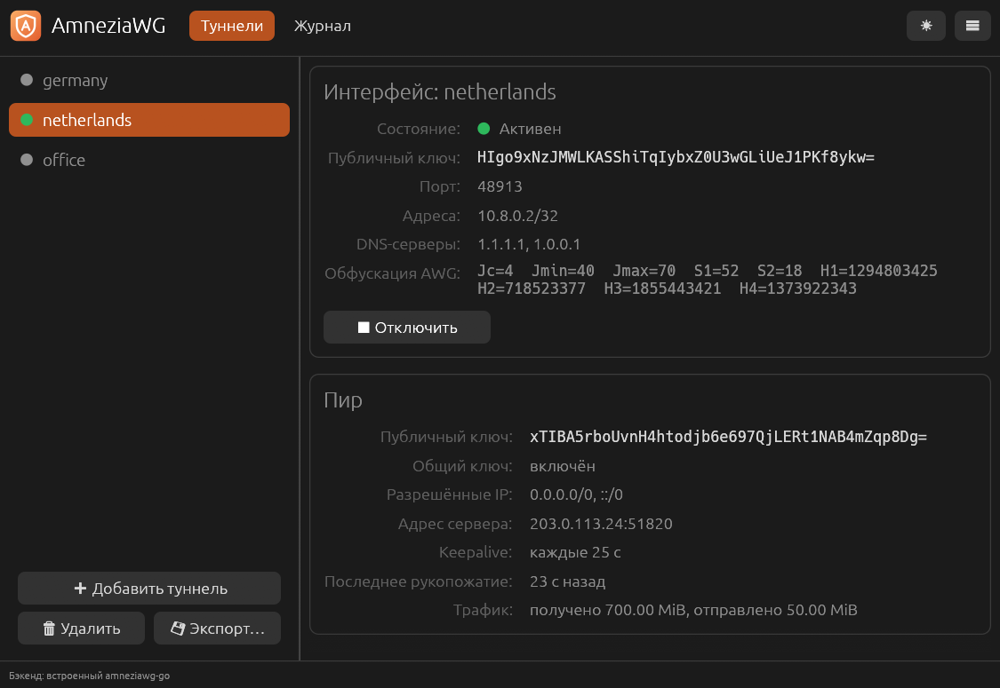
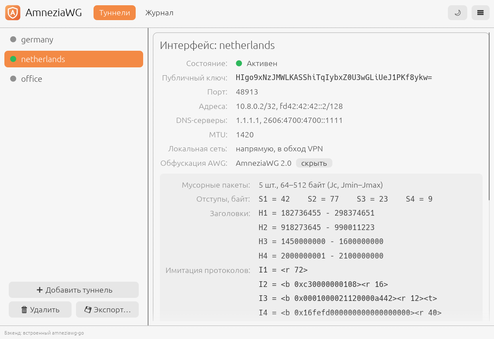
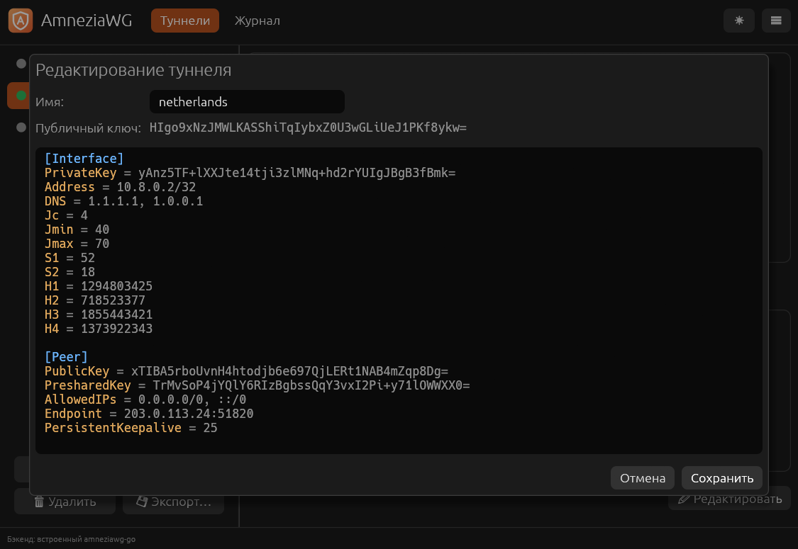

[English](README.md) | [Русский](README.ru_RU.md)

<p align="center">
  
</p>

<h1 align="center">Клиент AmneziaWG для Linux</h1>
<p align="center">Графический VPN-клиент AmneziaWG / WireGuard для Linux в одном исполняемом файле.</p>

[](https://github.com/coinman-dev/awg-linux-client/releases/tag/v0.1.0-beta)
[](https://github.com/coinman-dev/awg-linux-client/actions/workflows/release.yml)
[](#скачать)
[](#сборка)
[](LICENSE)

**awg-gui** — настольный клиент [AmneziaWG](https://docs.amnezia.org/ru/documentation/amnezia-wg/),
форка WireGuard с обфускацией трафика, сделанный для Linux по образцу
[amneziawg-windows-client](https://github.com/amnezia-vpn/amneziawg-windows-client). Написан на Rust
с нуля; окно рисуется с помощью [egui](https://github.com/emilk/egui), поэтому никаких
графических библиотек устанавливать не нужно. Userspace-реализация AmneziaWG (`amneziawg-go`)
и утилиты `awg` / `awg-quick` встроены в программу: она работает без модуля ядра и без других
пакетов AmneziaWG.

<p align="center">
  
</p>

> **0.1.0-beta — первая предварительная версия.** О проблемах пишите в
> [GitHub Issues](https://github.com/coinman-dev/awg-linux-client/issues) и прикладывайте текст
> со вкладки **Журнал**. awg-gui — независимый проект, не связанный с Amnezia.

## Скачать

| Вариант | Файл | Использование |
|---|---|---|
| Пакет для Linux | [awg-gui_0.1.0-beta_amd64.deb](https://github.com/coinman-dev/awg-linux-client/releases/download/v0.1.0-beta/awg-gui_0.1.0-beta_amd64.deb) | `sudo apt install ./awg-gui_0.1.0-beta_amd64.deb` ставит программу с ярлыком в меню, иконками и polkit-политикой. |

Ubuntu 24.04 и новее, Debian 13 и новее, amd64, Wayland или X11 с OpenGL.
Без рекламы и телеметрии: программа подключается только к вашим VPN-серверам.
[Все релизы](https://github.com/coinman-dev/awg-linux-client/releases) ·
[История изменений](CHANGELOG.ru_RU.md).

## Быстрый старт

1. Установите пакет: `sudo apt install ./awg-gui_0.1.0-beta_amd64.deb`.
2. Откройте **AmneziaWG** из меню приложений (**Интернет**) или выполните `awg-gui`.
3. **Добавить туннель** → импортируйте `.conf`-файл, вставьте текст конфига или ключ
   AmneziaVPN `vpn://`, либо перетащите файлы в окно.
4. Нажмите **Подключить** и введите пароль администратора (один раз за сеанс).
   При закрытии окна программа остаётся в системном трее.

## Возможности

- **Список туннелей** с индикаторами состояния; подключение и отключение кнопкой, двойным
  кликом или из меню трея. Как и в Windows-клиенте, активен один туннель за раз.
- **Импорт**: `.conf`-файлы (диалог или перетаскивание), вставленный текст конфига, **ключи
  AmneziaVPN `vpn://`**; из терминала — `awg-gui --import ФАЙЛ…`.
- **Редактор** с подсветкой синтаксиса и живым публичным ключом; **новый пустой туннель** со
  сгенерированной парой ключей; экспорт и удаление.
- **Живая статистика**: последнее рукопожатие, принятый и отправленный трафик, адрес сервера,
  порт и параметры обфускации AmneziaWG (Jc, Jmin, Jmax, S1–S4, H1–H4, I1–I5).
- Конфиги **AmneziaWG 1.0, 1.5, 2.0, 3.0 и 3.1**, а также обычного WireGuard; версия определяется
  автоматически, параметры обфускации показаны понятными строками по группам.
- **Локальная сеть в обход VPN** (меню ☰): при конфиге, направляющем весь трафик в VPN,
  частные адреса (192.168.x.x, 10.x.x.x, 172.16–31.x.x, link-local, IPv6 ULA) идут напрямую —
  принтеры, NAS и роутер остаются доступны; адреса внутри туннеля (его подсеть, частный DNS)
  по-прежнему идут через VPN. Реализовано правилами `ip rule` в рабочей копии конфига;
  сохранённый конфиг не меняется.
- Светлая, тёмная и системная темы; русский и английский интерфейс; журнал операций.

<p align="center">
  
  
</p>

## Интеграция с рабочим столом

- **Системный трей** (StatusNotifierItem): закрытие окна сворачивает программу в трей; меню
  трея открывает окно, переключает туннели и завершает программу. Иконка цветная при
  подключённом туннеле и серая без него. KDE Plasma поддерживает трей сразу; в GNOME нужно
  расширение AppIndicator (в Ubuntu включено по умолчанию). Без трея закрытие окна
  завершает программу.
- **Автозапуск** при входе в систему сразу в трей (меню ☰ → **Запускать при входе в систему**).
- **Один экземпляр**: повторный запуск показывает окно уже работающей программы.
- **Туннели остаются поднятыми** после закрытия окна и выхода из программы — как службы
  Windows у оригинального клиента.

## Как это устроено

```
awg-gui (ваш пользователь, GUI)
   │  JSON по stdin/stdout
   ▼
pkexec awg-gui --helper (root, тот же исполняемый файл)
   │
   ▼
awg-quick up/down, awg show all dump
   │
   ▼
модуль ядра amneziawg  ИЛИ  amneziawg-go (системный или встроенный)
```

Привилегированный helper запускается через polkit один раз за сеанс; пакет ставит политику
(`org.amnezia.awg-gui.helper`) с понятным сообщением и запоминанием авторизации на несколько
минут. Установленные в системе `awg`, `awg-quick`, `amneziawg-go` и модуль ядра имеют
приоритет над встроенными копиями.

## Настройки и данные

| Что | Где |
|---|---|
| Программа | `/usr/bin/awg-gui` |
| Конфиги туннелей | `~/.config/awg-gui/tunnels/<имя>.conf` (права 0600) |
| Настройки (язык, тема, обход локальной сети) | `~/.config/awg-gui/settings.json` |
| Копия конфига активного туннеля | `/run/awg-gui/<имя>.conf` (root, нужна для `awg-quick down`) |
| Встроенные `amneziawg-go`, `awg`, `awg-quick` | распаковываются в `/var/lib/awg-gui/bin/` при первой необходимости |
| Автозапуск | `~/.config/autostart/awg-gui.desktop` |

Имена туннелей подчиняются правилам имён сетевых интерфейсов Linux: до 15 символов из
`a-z A-Z 0-9 _ = + . -`.

## Командная строка

```bash
awg-gui                  # запустить GUI
awg-gui --minimized      # запустить свёрнутым в трей
awg-gui --import ФАЙЛ…   # импортировать .conf-файлы или файлы с ключами vpn://
awg-gui --install        # добавить ярлык в меню (для бинарника без пакета)
awg-gui --help
```

## Сборка

Нужны Rust 1.95+, компилятор C (`build-essential`), `git` и `curl`; Go скачивается
автоматически, если не установлен. Системные библиотеки для сборки не нужны.

```bash
packaging/build-backend.sh     # amneziawg-go, awg, awg-quick в vendor/ (встраиваются build.rs)
cargo test --locked
cargo build --release --locked # target/release/awg-gui, ~14 МБ, зависит только от libc
packaging/build-deb.sh         # dist/awg-gui_<версия>_<arch>.deb
```

Без встроенного бэкенда: `AWG_GUI_NO_EMBED=1 cargo build --release` (тогда в системе нужны
`amneziawg-tools` и модуль ядра или `amneziawg-go`).

Скриншоты без VPN-сервера (debug-сборка): `AWG_GUI_SCREENSHOT=out.png` сохраняет окно и
завершает программу, `AWG_GUI_DEBUG=helper|editor|paste|log` открывает нужный вид,
`AWG_GUI_FAKE_ACTIVE=имя` помечает туннель активным, `AWG_GUI_THEME=light|dark` выбирает тему.

## Автоматические релизы

Тег версии вида `v0.1.0-beta` запускает [release workflow](.github/workflows/release.yml).
Тег должен совпадать с `version` в `Cargo.toml`. GitHub собирает бэкенд и программу на
Ubuntu 24.04, прогоняет тесты, собирает и проверяет `awg-gui_<версия>_amd64.deb`, считает
`SHA256SUMS.txt` и публикует релиз. Теги с суффиксом через дефис помечаются как
предварительные версии.

## Лицензия

GNU General Public License v2 или новее — см. [LICENSE](LICENSE).

Встроенные компоненты сохраняют свои лицензии: [amneziawg-go](https://github.com/amnezia-vpn/amneziawg-go)
(MIT), [amneziawg-tools](https://github.com/amnezia-vpn/amneziawg-tools) (`awg`, `awg-quick`,
GPL-2.0) и Rust-библиотеки, из которых собрана программа (egui, winit, ksni, zbus и другие,
MIT или Apache-2.0), включая шрифты egui (Hack, Ubuntu Light, Noto Emoji, emoji-icon-font) под
их собственными свободными лицензиями. AmneziaWG и WireGuard — товарные знаки их владельцев.
